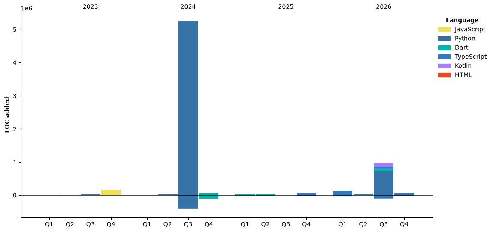

## 👋 Hi, I'm Andrey

<!--START_SECTION:waka-->


**I'm an Early 🐤** 

```text
🌞 Morning                1663 commits        ███████░░░░░░░░░░░░░░░░░░   26.51 % 
🌆 Daytime                2845 commits        ███████████░░░░░░░░░░░░░░   45.35 % 
🌃 Evening                1392 commits        ██████░░░░░░░░░░░░░░░░░░░   22.19 % 
🌙 Night                  373 commits         █░░░░░░░░░░░░░░░░░░░░░░░░   05.95 % 
```
📅 **I'm Most Productive on Friday** 

```text
Monday                   761 commits         ███░░░░░░░░░░░░░░░░░░░░░░   12.13 % 
Tuesday                  635 commits         ███░░░░░░░░░░░░░░░░░░░░░░   10.12 % 
Wednesday                1037 commits        ████░░░░░░░░░░░░░░░░░░░░░   16.53 % 
Thursday                 964 commits         ████░░░░░░░░░░░░░░░░░░░░░   15.37 % 
Friday                   1259 commits        █████░░░░░░░░░░░░░░░░░░░░   20.07 % 
Saturday                 964 commits         ████░░░░░░░░░░░░░░░░░░░░░   15.37 % 
Sunday                   653 commits         ███░░░░░░░░░░░░░░░░░░░░░░   10.41 % 
```


📊 **This Week I Spent My Time On** 

```text
🕑︎ Time Zone: Europe/Kaliningrad

💬 Programming Languages: 
Markdown                 15 hrs 3 mins       █████████████░░░░░░░░░░░░   53.61 % 
Python                   7 hrs 32 mins       ███████░░░░░░░░░░░░░░░░░░   26.84 % 
YAML                     1 hr 17 mins        █░░░░░░░░░░░░░░░░░░░░░░░░   04.63 % 
Bash                     1 hr 3 mins         █░░░░░░░░░░░░░░░░░░░░░░░░   03.76 % 
Text                     59 mins             █░░░░░░░░░░░░░░░░░░░░░░░░   03.54 % 

🔥 Editors: 
Claude Code              25 hrs 26 mins      ███████████████████████░░   90.59 % 
VS Code                  2 hrs 38 mins       ██░░░░░░░░░░░░░░░░░░░░░░░   09.41 % 

💻 Operating System: 
Linux                    28 hrs 5 mins       █████████████████████████   100.00 % 
```

🤖 **AI Coding This Week** 

```text
⏱ AI Coding Time: 27 hrs 40 mins (98.54%)

✍️ 13,095 lines written by AI, 13 lines written by hand (99.9% AI-written)

🔤 24,711,865 Input Tokens, 6,928,030 Output Tokens

💵 $436.26 Estimated AI Cost This Week

🧠 28 AI Sessions, 160 AI Prompts

Opus                     14,172 lines        █████████████████████████   100.00 % 
Claude-Code              0 lines             ░░░░░░░░░░░░░░░░░░░░░░░░░   00.00 % 

🔎 AI Coding Insights:
🤖 AI-Driven — 99.9% of written lines came from AI
📚 Verbose Prompter — average 7,501 characters per prompt
🔁 Iterative Prompter — average 6 prompts per session
🚀 High AI Trust — 0.11% of changed lines were hand-edited
```

**Timeline**




 Last Updated on 31/10/2026 21:52:36 UTC
<!--END_SECTION:waka-->

